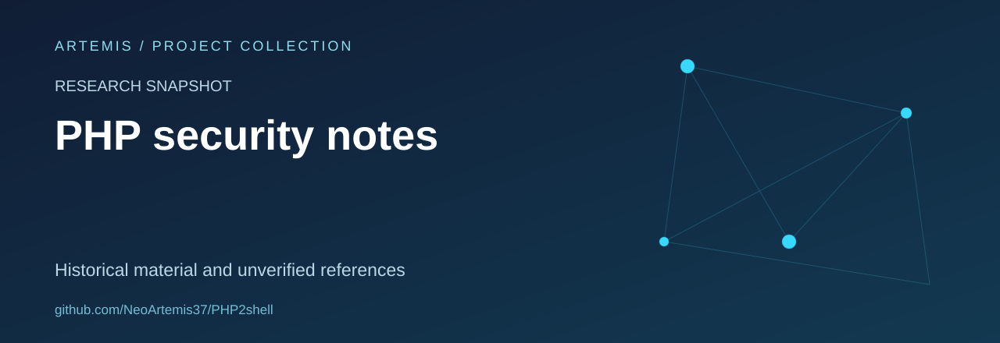

# PHP security research snapshot

Historical Python research material with unverified vulnerability references.

## Scope and status

This repository is a research snapshot, not a validated security advisory or a supported product. Its historical CVE references and impact claims require independent verification before being cited.

## Repository contents

Python research scripts. The code and its history are retained; this README is a presentation and provenance update.

## Review priorities

- Document the exact provenance and the limits of historical claims.
- Separate reproducible observations from assumptions.
- Prefer defensive analysis, local fixtures and clear remediation notes.

## Attribution and licensing

No new license or authorship claim is introduced by this documentation update. Verify the provenance and applicable permissions before reuse.

## About this collection

Maintained as part of [Artemis’s project and learning collection](https://github.com/NeoArtemis37).
